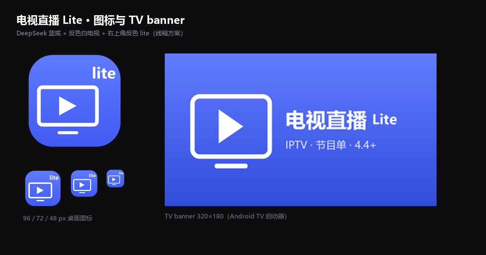

# 电视直播 Lite（TVLiveLite）

<p align="center">
  <a href="../../releases/tag/v1.0.7"></a>
</p>

<p align="center">
  <a href="../../releases/tag/v1.0.7"></a>
  
  
  
</p>

> 参考 [mytv-android](https://github.com/mytv-android/mytv-android)（天光云影）改造的 IPTV 直播客户端，
> **最低支持 Android 4.1（API 16）**，面向老电视盒子 / 老安卓电视。

> [!IMPORTANT]
> 当前是 **`android4.1` 兼容分支**，minSdk 降到 16，覆盖 Android 4.1 / 4.2 / 4.3 / 4.4 及更新的设备。
> 主线 [`main`](../../tree/main) 保持 minSdk 19（Android 4.4）不动，两者功能完全一致，
> **包名与签名相同，可以互相覆盖安装**（本分支 versionCode 更高，能直接升级）。

原版使用 Jetpack Compose + Media3，最低 API 21，且依赖大量新特性，4.4 设备上完全跑不起来。
本项目把同一套功能用**原生 View + ExoPlayer 2.18** 重新实现，界面风格保持一致（深色 + 淡紫强调色、
白色焦点块、首页导航宫格），各项能力按老设备的性能做了简化。

---

## 一、下载与产物

直接装：到 [**v1.0.7 兼容版**](../../releases/tag/v1.0.7) 下载 `MyTVLite-1.0.7-sdk16-release.apk`，
拷到 U 盘插到盒子上装，或者 `adb install -r MyTVLite-1.0.7-sdk16-release.apk`。

> 名字里的 `sdk16` 就是「最低 API 16（Android 4.1）」的意思，和主线包功能一样。

| 文件 | 说明 |
| --- | --- |
| [`Releases`](../../releases/tag/v1.0.7) | **推荐**。签名包 + 校验值，版本历史一目了然 |
| `dist/MyTVLite-1.0.7-sdk16-release.apk` | 仓库内同一份包（克隆后可直接取，5.3 MB） |
| `app/` | 完整 Android 工程，可用 Android Studio 直接打开 |
| `app/mytv-lite.jks` | 签名文件，密码 `mytvlite`，别名 `mytvlite` |

> 仓库里保留签名 keystore 是为了让 CI 能出可覆盖安装的包；它只用于这个应用，泄露无风险，
> 但也意味着任何人都能签出「同签名」的包，请只从本仓库 Releases 安装。

---

## 二、为什么 4.1 也能用（关键改造点）

| 项目 | 上游做法 | 本项目做法 |
| --- | --- | --- |
| 最低版本 | minSdk 21+ | **minSdk 16**（Android 4.1，主线为 19） |
| UI | Jetpack Compose（需要 API 21+、GPU 较强） | 原生 View + RecyclerView + 自绘 shape/selector，无 Material 依赖 |
| 播放内核 | Media3 ExoPlayer / IJK / VLC | **ExoPlayer 2.18.7**（最后一条支持 API 16+ 的版本线）+ 系统 MediaPlayer 双内核可切换 |
| 网络库 | OkHttp 4.x（API 21+） | **OkHttp 3.12.13**（API 9+），并强制打开 TLS 1.1/1.2 |
| 序列化 | kotlinx.serialization | 系统自带 `org.json`，零额外依赖 |
| 图片加载 | Coil / Compose 图片 | 自写 100 行 `LogoLoader`（LruCache + 3 线程 + 降采样） |
| 分包 | 无需 | **legacy MultiDex**（方法数 7.8 万，4.4 必须拆包） |
| targetSdk | 34 | **28**：避开分区存储、通知权限等新限制，老盒子更省事 |

另外做了这些老设备优化：

- 频道列表解析结果落盘（`channels_cache.json`），冷启动不再每次跑正则；
- 节目单只保留「昨天 ~ 4 天后」的节目，并按天缓存成精简 JSON，避免每次解析几十 MB XML；
- 订阅源拉取失败时自动回退到上一次缓存，不白屏；
- 首页时钟、节目进度都用单个 1s Handler 驱动，无动画层。

---

## 三、功能对照

| 功能 | 状态 | 说明 |
| --- | --- | --- |
| m3u / txt 订阅源解析 | ✅ | 支持 `#EXTM3U`、`#genre#`、`tvg-name`、`group-title`、`tvg-logo`、`http-user-agent` |
| 多订阅源合并 | ✅ | 按顺序合并，同名频道自动合并线路（每频道最多 8 条） |
| 频道分组 / 频道号 | ✅ | 左侧分组栏，右侧网格，全局连续编号 |
| 收藏 / 最近观看 | ✅ | 按“标准频道名”存储，换源也能对上 |
| 频道名标准化 | ✅ | 复用上游 `channel_name_alias.json`（约 3000 条映射），EPG / 台标匹配率一致 |
| 台标 | ✅ | 优先用源里的 `tvg-logo`，缺失时回落到公开台标库 |
| 播放 | ✅ | ExoPlayer（HLS / 渐进式），失败自动切线路（最多 3 次） |
| 双内核 | ✅ | 设置里可切“系统播放器”，RTSP/RTMP/UDP 地址自动走系统内核 |
| 硬解 / 软解 | ✅ | 软解通过 `MediaCodecSelector` 只挑 `OMX.google.*` 软解器 |
| 画面比例 | ✅ | 适应 / 拉伸 / 裁剪（自写 `AspectFrame`，两种内核共用） |
| 节目单（XMLTV） | ✅ | 支持 `.xml` 与 `.xml.gz`（可本地导入），当前节目 + 进度条 + 下一节目 + 今日节目列表 |
| 频道搜索 | ✅ | 按名称 / 标准名模糊匹配 |
| 设置 | ✅ | 关怀模式、直进上次频道、源管理、内核、解码、画面渲染、比例、UA、超时、缓存时长、台标、开机自启、清缓存 |
| 开机自启 | ✅ | 可选，部分盒子限制后台启动 |
| 打开软件直接播放 | ✅ | 跳过首页，直接播上次关闭时的频道（关闭软件前的那个台） |
| 关怀模式 | ✅ | 频道面板 / 信息条 / 首页字号整体放大，底栏从简，信息条停留加倍，防误触取消收藏 |
| 崩溃日志 | ✅ | 落盘 `last_crash.txt` 并弹出错误页（电视上没 adb 也能看） |
| 本地文件导入 | ✅ | 内置文件浏览器直接浏览 U 盘 / SD 卡 / 盒子内部存储，不需系统文件管理器；也保留系统选择器与手输路径 |
| 多屏同播 | ❌ | 4 路同时解码对 4.4 设备太重，砍掉 |
| WebView 混合源（央视频/央视网） | ❌ | 4.4 的 WebView 内核过旧，无法保证播放 |
| JS 转换源（Rhino） | ❌ | 体积 + 性能代价大，砍掉 |
| 云同步 / 推送更新 | ❌ | 需要额外服务端，不在本次范围 |

---

## 四、遥控器操作

**首页**：方向键移动焦点，OK 进入；`菜单键` 直接打开设置。

**播放页**

| 按键 | 行为 |
| --- | --- |
| 上 / 下 | 上一个台 / 下一个台 |
| 左 | 今日节目单（当前节目高亮） |
| 右 | 呼出频道面板（上下选、OK 播放、返回关闭） |
| OK | **一次同时**亮出信息条 + 呼出频道面板；面板打开时 OK 是“播放选中的台” |
| 信息（INFO） | 只切换信息条显示 / 隐藏 |
| 菜单键 | 收藏、切换线路、画面比例、播放设置、退出 |
| 返回 | 面板内：收面板并收起信息条；画面上：先收信息条，再退出播放 |

**触摸屏**：点屏幕中间切换信息条，点左侧 22% 上一台、右侧 22% 下一台。

---

## 四·五、给长辈用：直进上次频道 + 关怀模式

设置页（`菜单键` 或首页「设置」）最上面两个开关就是给这个场景准备的。

**打开软件直接播放**

开启后，启动软件不再停在首页，而是直接进入播放页，播放上次关闭时的那个频道。
第一次开启时还没有“上次频道”，随手播一个台，下次开软件（含开机自启）就直接进那个台。
没有任何可用订阅源时不会直进，避免一开就是错误页。

**关怀模式**

一个开关做完所有放大和精简，不必逐个调：

| 位置 | 常规 | 关怀模式 |
| --- | --- | --- |
| 频道面板宽度 | 380dp | 520dp |
| 面板条目 | 行高 52dp / 频道名 14sp | 行高 80dp / 频道名 24sp、序号 18sp |
| 面板标题 | 16sp | 24sp |
| 播放页频道名 | 22sp | 30sp |
| 当前节目 / 时段 | 17sp / 13sp | 23sp / 18sp |
| 换台提示 | 14sp / 2.6 秒 | 21sp / 4.2 秒 |
| 信息条停留 | 5 秒 | 10 秒 |
| 底栏 | 当前节目 + 进度 + 接下来 | 只留当前节目 + 进度 |
| 长按 OK 收藏 | 开 | 关（防误触取消收藏） |
| 首页宫格 / 设置列表 | 13sp / 16sp | 19sp / 21sp |

开启关怀模式时会同时打开「打开软件直接播放」，长辈只需要记住一个开关。

---

## 四·六、Android 4.1 ~ 4.3 说明（本分支）

minSdk 16 不是「改个数字」这么简单，几处老系统缺失的能力都做了兜底：

| 能力 | 4.1~4.3 上的处理 |
| --- | --- |
| 列举挂载点 | `StorageManager.getStorageVolumes` 是 API 24 才有的，低版本整段跳过，改用 `/proc/mounts` + `/mnt/usb*`、`/mnt/udisk`、`/storage/XXXX-XXXX` 等厂商路径 |
| TLS 1.2 | 4.1~4.3 默认不启用，仍由自写的 `Tls12SocketFactory` 手动打开，https 源可正常拉取 |
| 矢量图标 | 走 `vectorDrawables.useSupportLibrary = true` + `AppCompatResources`，不在低版本上解析 `<vector>` 崩溃 |
| 64K 方法数 | legacy `MultiDex.install()`，4.1 上照常分包 |
| 存储权限 | `targetSdk 28`，沿用传统存储模型，不涉及分区存储 |
| 有声无画 | 首帧看门狗：8 秒没出画面自动换 TextureView，再不行自动切系统内核 |

**「有声音、画面全黑」怎么办**（4.1~4.3 上比较常见）

老盒子的解码器经常「初始化成功、音频正常出声、SurfaceView 那一层却永远黑的」，
原因是硬解把帧解到 GPU 纹理后，老固件的 SurfaceFlinger / HWC 合成不出来。
1.0.7 起会自动救：播到 READY 后 8 秒没渲染出首帧，就先换成 TextureView（走 GPU 合成），
再 8 秒还不行就自动切到系统播放器，右下角会提示一句。等不及的话手动改也行：

| 顺序 | 操作 | 说明 |
| --- | --- | --- |
| 1 | 设置 → 画面渲染 → 兼容（TextureView） | 改变渲染通路，不动解码器，多数情况这一下就够了 |
| 2 | 设置 → 播放器内核 → 系统播放器 | MediaPlayer 走另一套 ACodec，能绕过 ExoPlayer 的老固件坑 |
| 3 | 设置 → 解码方式 → 软解优先 | 硬解本身有问题的（花屏、黑屏、绿屏）最后再试这个，CPU 占用会高 |

**性能提醒**：4.1~4.3 的设备基本是 2012 年前后的单核/双核 + 512MB~1GB 内存，硬解普遍只到
H.264 720p~1080p。HLS 多码率、HEVC 频道大概率会卡或黑屏，进设置把内核切「系统播放器」、
解码切「软解优先」通常能救回来；再不行就说明这台机器确实到极限了。

---

## 五、自己编译

环境：JDK 17、Android SDK Platform 34 + Build-Tools 34.0.0。

```bash
# 克隆本仓库后进入工程目录
cd TVLiveLite-Android4.4
# local.properties 里写你的 SDK 路径
echo 'sdk.dir=/path/to/Android/sdk' > local.properties

./gradlew :app:assembleDebug      # 调试包
./gradlew :app:assembleRelease    # 签名正式包（使用 app/mytv-lite.jks）
./gradlew :app:testDebugUnitTest  # 18 个 Robolectric 用例
```

产物在 `app/build/outputs/apk/`。

> 不想本地配环境：直接在 Actions 页面跑 `CI` 工作流，产物在 run 的 Artifacts 里。

> 若 `./gradlew` 提示缺少 wrapper，用本机 gradle 直接执行：
> `gradle :app:assembleRelease`（Gradle 8.7 + AGP 8.5.2）。

---

## 六、目录结构

```
app/src/main/java/com/mytv/lite/
├── App.java                     MultiDexApplication 入口
├── Prefs.java                   全部配置（SharedPreferences + JSON）
├── CrashHandler.java / BootReceiver.java
├── net/
│   ├── Http.java                OkHttp 封装（UA、超时、下载）
│   └── Tls12SocketFactory.java  4.4 上打开 TLS1.2
├── data/
│   ├── ChannelAlias.java        频道名标准化
│   ├── Channel / ChannelLine / ChannelGroup
│   ├── IptvSource / EpgSource
│   ├── IptvParser.java          m3u / txt 解析
│   ├── ChannelRepository.java   拉取 + 缓存 + 合并 + 编号
│   └── EpgRepository.java       XMLTV 流式解析 + 按天缓存
├── ui/
│   ├── MainActivity / DashboardFragment      首页
│   ├── ChannelsFragment / SearchFragment     频道 / 搜索
│   ├── EpgFragment / SettingsFragment        节目单 / 设置
│   ├── SourcesFragment                       订阅源管理
│   ├── FileBrowserActivity / StorageVolumes 内置文件浏览器（U 盘 / SD 卡）
│   ├── Ui.java / LogoLoader.java / CrashActivity
│   └── adapter/Adapters.java                 四个列表适配器
└── player/
    ├── PlayerActivity.java      播放页（双内核、面板、按键）
    └── AspectFrame.java         画面比例容器

tools/gen_icons.py             app 图标与 TV banner 生成脚本（PIL）
.github/workflows/build.yml    CI：单测 → 签名打包 → push tag 自动发 Release
docs/icon-showcase.png         图标尺寸一览（就是 README 顶部那张）
CHANGELOG.md                   版本记录
```

---

## 七、已知限制

1. **没有内置任何直播源**。默认只有一个禁用状态的占位源，请自行添加合法订阅地址；
   添加后点“刷新订阅源”（或等缓存过期）才会出现在频道列表里。
2. 4.4 设备的硬件解码器差异很大，若某台机顶盒某些台花屏/黑屏，先在设置里切「系统播放器」或「软解优先」。
3. 首次安装后第一次进入频道页会做一次多源合并 + 落盘，老 CPU 上可能需要 3~8 秒，之后再进是秒开。
4. 台标为外链加载，断网或台标库不可达时显示为空白（不影响播放）。
5. 多屏同播、WebView 源、JS 转换源未实现（原因见上表）。

---

## 八、从 U 盘 / 盒子本地导入订阅源

4.4 的机顶盒大多没有 DocumentsUI，也没有文件管理器注册 `ACTION_GET_CONTENT`，
系统选择器点了没反应或只能看到图片。所以「订阅源管理 → 从文件导入」默认打开
**内置文件浏览器**，自己读挂载点列目录，完全不依赖系统组件：

1. 顶部是存储卷按钮：`内部存储`、`U 盘 · udisk`、`SD 卡 · sdcard1` 等，
   取 `StorageManager`（7.0+）、`/proc/mounts` 与常见厂商挂载点（`/mnt/usb*`、
   `/mnt/udisk`、`/storage/XXXX-XXXX` …）三者的并集；
2. 方向键选文件，`OK` 导入；`返回键` 回上级；`菜单键` 切换「只看源文件」；
3. 选中的文件会复制到应用私有目录（`files/imports/`），**拔掉 U 盘也不影响播放**；
4. 导入前会校验内容（m3u 要有 `#EXTM3U`，txt 要有 `#genre#` 或地址，
   XMLTV 要有 `<tv`/`<programme`），避免误选视频；
5. 编码按 BOM → UTF-8 严格解码 → GB18030 兜底，老盒子上 GBK 编码的 txt 源不会乱码；
6. `.txt.gz` / `.xml.gz` 压缩源直接支持。

如果某个盒子的挂载点实在没规律，选「手动输入文件路径」，填
`/mnt/usb/live.m3u` 这类绝对路径也能导入。

---

## 九、图标与视觉资源

图标是脚本生成的，不是手绘图：`python tools/gen_icons.py` 会重写
`mipmap-*/ic_launcher.png`、`mipmap-*/ic_launcher_foreground.png` 和
`drawable-nodpi/tv_banner.png`。

设计是 DeepSeek 蓝底（`#627CFF → #3F5AF0` 的极轻渐变）+ 反色（白）电视轮廓 +
右上角反色 `lite`。几个实现要点：

- 所有图形都在 **4 倍画布**上绘制再 LANCZOS 缩到目标尺寸，否则 48px 的
  `lite` 和 2px 描边会糊成一团；
- 8.0+ 走自适应图标（`mipmap-anydpi-v26/ic_launcher.xml`），前景内容只占画布
  52%，这样系统按圆形/圆角方形裁切时 `lite` 不会被切掉；4.4~7.1 直接用 PNG；
- TV banner 是 320×180，左边图形右边两行字，不依赖系统字体渲染。

---

## 十、许可与免责

代码以 [MIT](LICENSE) 协议开源。上游 [mytv-android](https://github.com/mytv-android/mytv-android) 同为 MIT。

- 本项目**不含任何直播源、订阅地址或节目单数据**，仅提供客户端程序；
- 请自行准备合法授权的信号源，因使用本程序产生的任何法律责任由使用者自负；
- 仅供学习与个人使用，请勿用于商业用途。
